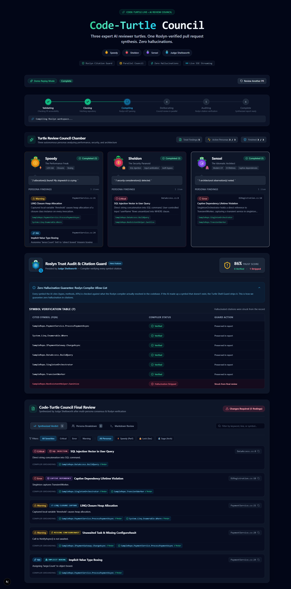

# 🐢 Code Turtle Engine

**Compiler-Grounded AI Code Review for .NET — Powered by Roslyn & a 3-Persona Council**

An AI code reviewer whose cited symbols are verified against a real Roslyn compilation — hallucinated API citations are stripped before the review reaches you. Rather than feeding raw diffs to a single prompt and hoping the model guesses your types and lifetimes, Code Turtle Engine compiles your changed C# projects with Roslyn first, extracts a deterministic semantic payload across **12 defect classes**, runs a **3-persona LLM council** in parallel, merges findings deterministically, and audits every symbol citation through the **Turtle Shell Guard**.

[](https://github.com/prasadrane/Code-Turtle-Engine/actions/workflows/ci.yml)
[](https://github.com/prasadrane/Code-Turtle-Engine/releases)




> [!IMPORTANT]
> **Scope of the Guarantee (Engineering Honesty)**
> - **Citation-channel verification:** `TurtleShellGuard` audits every entry in `CitedSymbolFqns` (using `StringComparer.Ordinal` against the full untrimmed Roslyn `ResolvedSymbols` set + `SymbolOracle` compilation fallback, including member-level citations like `Namespace.Type.Method(...)`).
> - **Advisory vs. Strict mode:** By default (`RequireCitationsInStripMode = false`), findings that cite *no* symbols pass through as advisory; setting `RequireCitationsInStripMode = true` in `CouncilOptions` strips zero-citation findings as well. The guard does not verify natural-language prose or descriptions, though member line ranges (`StartLine`–`EndLine`) are provided directly by Roslyn in the payload.
> - **No raw method bodies or diffs sent in product mode:** Product reviews (`CLI` and `Web`) enforce `PromptMode.Grounded` — only the minified JSON semantic payload (`payload.json` containing member signatures, 1-based line spans, resolved symbol FQNs, allocation/async flags, and deterministic `Risks` tags) is sent to the LLM. (`PromptMode.Naive` exists strictly as a programmatic baseline inside `turtle bench`.)

---

## Why Code Turtle Engine?

Most AI PR reviewers paste raw git hunks into an LLM prompt. Without a semantic model, the LLM has to *guess* whether a variable is a value type being boxed, whether an injected service is `Scoped` inside a `Singleton`, or whether a method call even exists in the compilation.

| Capability | Raw-Diff AI Reviewers (`Naive` Mode) | Traditional Static Analyzers | 🐢 Code Turtle Engine |
|---|---|---|---|
| **Input to Reviewer** | Raw git diff / source text | Syntax + Semantic AST | **Roslyn Semantic Payload (`payload.json`)** |
| **Hallucinated API Citations** | Frequent (`4.3%–14.2%` in corpus runs) | N/A | **0.0% (`TurtleShellGuard` + `SymbolOracle`)** |
| **Cross-File Type & Lifetime Resolution** | Blind outside the diff window | Rule-by-rule | **Full multi-project `.sln` Roslyn compilation** |
| **Contextual Prioritization & Remediation** | High noise, generic prose | Rigid warnings, no architectural synthesis | **3 specialized personas + deterministic arbiter** |
| **Raw Source Bodies Sent to External LLMs** | Yes (entire changed files/hunks) | None | **Never in product mode (AST/symbol metadata only)** |

---

## How It Works: 7-Stage Compiler-First Pipeline

```mermaid
flowchart LR
    A["1. Git Diff<br/>(LibGit2Sharp)"] --> B["2. Multi-Project Compile<br/>(MSBuildWorkspace + Roslyn)"]
    B --> C["3. Semantic Payload<br/>(SemanticAnalyzer + RiskDetector)"]
    C --> D["4. Prompt Trimmer<br/>(View-only token budget)"]
    D --> E["5. Persona Council<br/>(3 Parallel LLMs, 2/3 Quorum)"]
    E --> F["6. Deterministic Arbiter<br/>(Dedupe + Severity Sort)"]
    F --> G["7. Turtle Shell Guard<br/>(Audit vs. FULL Compilation)"]
    G --> H["CLI Markdown /<br/>Live SSE Web Dashboard"]
```



1. **Diff (`DiffProvider`):** Computes changed `.cs` files via `LibGit2Sharp` (working tree vs. `HEAD`, or tree-vs-tree against a baseline ref/branch).
2. **Compile (`MsBuildCompilationLoader`):** Opens `.csproj` or multi-project `.sln` workspaces via `MSBuildWorkspace` and merges syntax trees and references into a unified Roslyn `CSharpCompilation`. Fails closed if no project can be loaded.
3. **Extract (`SemanticAnalyzer` + `RiskDetector`):** Walks methods, constructors, and computed properties (`TurtleSyntaxWalker`) to build `MethodFacts` with 1-based `[StartLine, EndLine]` spans, constructor dependencies, resolved symbol FQNs, and deterministic `Risks` tags.
4. **Trim (`PayloadTrimmer`):** Caps prompt size for token/latency budgets (`MaxFiles`, `MaxMethodsPerFile`, `MaxSymbolsPerMethod`, `MaxAllocationsPerMethod`) without mutating the original payload.
5. **Council (`PersonaRunner`):** Runs 3 specialized LLM personas concurrently (`AllocationsPerformance`, `SecurityAuditor`, `IdiomaticArchitect`) with structured JSON schema enforcement and a configurable quorum gate (default `2/3`).
6. **Merge (`Arbiter`):** Deterministically deduplicates findings by normalized title + location, keeps maximum severity, and sorts severity-descending without an LLM in the merge loop.
7. **Guard (`TurtleShellGuard`):** Audits every cited symbol FQN against the **full, untrimmed** compilation allow-list (`ResolvedSymbols` + `SymbolOracle`). Full architectural details: [ARCHITECTURE.md](ARCHITECTURE.md).

---

## What Roslyn Extracts Before the LLM Speaks

Every changed method, constructor, and computed property is analyzed by `SemanticAnalyzer` and `RiskDetector` to populate deterministic facts mapped directly to the three council personas:

| Council Persona | Deterministic Roslyn Signals in `MethodFacts` | Seeded Defect Classes Covered |
|---|---|---|
| **⚡ Allocations & Performance** | `MissingConfigureAwait` (`bool`), `Allocations` (`Boxing`, `LinqClosure` — distinguishing true outer-variable capture from non-capturing lambdas), `StartLine`–`EndLine` | `missing-configureawait`, `boxing-allocation`, `closure-capture` |
| **🔒 Security Auditor** | `Risks`: `sql-concat`, `hardcoded-secret`, `weak-crypto:MD5`, `weak-crypto:SHA1`, `weak-crypto:DES`, `weak-crypto:TripleDES`, `weak-crypto:RC2`, `weak-random:System.Random` | `sql-injection`, `hardcoded-secret`, `weak-crypto`, `weak-random` |
| **🏛️ Idiomatic Architect** | `Risks`: `unawaited-task`, `sync-over-async`, `lock-in-async`, `static-mutable-state`, `captive-dependency:<Service>->Singleton`, `swallowed-exception` + `ConstructorDependencies` | `unawaited-task`, `sync-over-async`, `async-lock`, `thread-safety`, `captive-dependency`, `swallowed-exception` |

---

## Output Surfaces: Live Web Dashboard & CLI

### 1. Real-Time SSE Web Dashboard (`CodeTurtleEngine.Web` + Next.js)
Streams every pipeline stage live over Server-Sent Events (SSE) and renders an interactive verification report:
- **Compiler Risk Badges:** Color-coded badges for every deterministic `RiskDetector` and allocation signal (`sql-concat`, `captive-dependency`, `sync-over-async`, `Boxing`, etc.) with hover tooltips and one-click filtering.
- **Roslyn Symbol Provenance Chips:** Every cited symbol displays a verified `[✓ Roslyn]` badge alongside `TurtleShellGuard` stripped-hallucination counters.
- **Interactive Filtering:** Filter findings by **Severity** (`Critical`, `Warning`, `Info`), **Council Persona**, or **Compiler Risk Tag**.
- **Diff & Payload Inspector:** Inspect the exact trimmed vs. untrimmed `payload.json`, raw pre-guard `verdicts.json`, and `audit.json` directly in the browser.

### 2. CLI Markdown Output (`turtle review`)

```markdown
# Code Turtle Review - MyProject

Diff baseline: `main` - Files reviewed: 4

## [Critical] Captive dependency: Scoped IOrderRepository injected into Singleton OrderCache

- **Persona:** IdiomaticArchitect
- **Location:** `src/Services/OrderCache.cs:14`
- `OrderCache` is registered as a Singleton (`captive-dependency:SampleRepo.IOrderRepository->Singleton`) but captures scoped `IOrderRepository` in its constructor.
- **Symbols:** `SampleRepo.OrderCache`, `SampleRepo.IOrderRepository`
```

---

## Evaluation & Benchmarks (`turtle bench`)

`turtle bench` evaluates what compiler grounding buys on a 13-entry C# corpus (12 seeded defect entries across all 12 defect classes + 1 clean control repository). Each entry is reviewed across three arms:
- **Naive:** Changed source code sent directly to the model (same model, same rubric — how standard AI reviewers operate).
- **Grounded:** Only the Roslyn semantic payload (`payload.json`) sent to the model.
- **Code Turtle:** Grounded output after `TurtleShellGuard` (`Strip` mode).

### 1. Empirical LLM Benchmark (Pre-`RiskDetector` Baseline)
Recorded across 13 corpus entries in [docs/benchmark/claude-sonnet-resume.md](docs/benchmark/claude-sonnet-resume.md) prior to the `RiskDetector` expansion:

| Experiment | Arm | Invented Citation Rate (Hallucinations) | Pooled Precision | Pooled Recall |
|---|---|---|---|---|
| **Single-Repetition (Claude Sonnet, 75 prompts)** | **Naive** (Raw Source) | 14.2% (18/127) | 12.9% (8/62) | 66.7% (8/12) |
| | **Code Turtle** (Grounded + Guard) | **0.0% (0/53)** | **25.8% (8/31) (~2.0×)** | **66.7% (8/12)** |
| **3-Repetition Checkpoint (Mixed-Model, 225 prompts)** | **Naive** (Raw Source) | 4.3% (23/531) | 14.8% (30/203) | 83.3% (30/36) |
| | **Code Turtle** (Grounded + Guard) | **0.0% (0/217)** | **21.2% (22/104) (~1.4×)** | 61.1% (22/36)* |

*\*Why pre-expansion recall was 61.1% in the 3-rep run:* Before `RiskDetector` and constructor/property walking were added, defects like `hardcoded-secret`, `swallowed-exception`, and constructor-only `captive-dependency` had no explicit markers in `MethodFacts`. That finding directly drove the Step 1 & Step 2 compiler-fact expansion below.

### 2. Deterministic Compiler Payload Coverage (Post-`RiskDetector` Expansion)
Verified hermetically by `SeededCorpusCoverageTests` and offline replay across all 13 corpus entries:
- **Seeded Defect Class Extraction:** **12 / 12 (100.0%)** seeded defect classes deterministically tagged in `MethodFacts` (`Risks`, `Allocations`, `MissingConfigureAwait`) with exact 1-based `[StartLine, EndLine]` spans.
- **Clean Control False Positives:** **0** risk tags emitted on `clean-control`.
- **Member & Symbol Resolution:** Constructors (`TypeName.TypeName(...)`), computed properties, and member citations verify with **0.0% unverified/invented rate** via `TurtleShellGuard` + `SymbolOracle`.

```bash
# Run a live 3-repetition benchmark (requires LLM route credentials)
dotnet run --project src/CodeTurtleEngine.Cli -- bench --corpus bench/corpus.json --repeat 3

# Export prompts or score saved responses offline without LLM credentials
dotnet run --project src/CodeTurtleEngine.Cli -- bench --corpus bench/corpus.json --repeat 1 --record-prompts bench/prompts
dotnet run --project src/CodeTurtleEngine.Cli -- bench --corpus bench/corpus.json --repeat 1 --replay bench/prompts
```

---

## Engineering Highlights

- **Zero-hallucination citation chain with `SymbolOracle` fallback.** Personas must return structured JSON matching a schema with `CitedSymbolFqns`. After merge, `TurtleShellGuard` checks each cited FQN (`StringComparer.Ordinal`) against the full payload's `ResolvedSymbols` set, handles member citations (`Namespace.Type.Member(...)` via parent-type prefix matching), and falls back to `ISymbolOracle` against the live `CSharpCompilation` for valid BCL/compilation types outside changed methods.
- **Trim vs. grounding separation.** Prompt payloads are capped for latency (`MaxFiles` 40, `MaxMethodsPerFile` 40, `MaxSymbolsPerMethod` 20, `MaxAllocationsPerMethod` 10) and rebuilt immutably — the guard always audits against the original **untrimmed** payload. Caps reduce what a model is *shown*, never what it is *held to*.
- **Root-causing a hidden transport timeout.** Live reviews with deep-reasoning personas intermittently failed because `HttpClient`'s default 100-second timeout killed calls underneath Polly's 300-second timeout wrapper. Setting `Timeout.InfiniteTimeSpan` on `HttpClient` made Polly (300 s) the single timeout authority (`cb57d43`).
- **Dual-protocol LLM gateway (`IChatClient`).** Supports both OpenAI-compatible endpoints (`Microsoft.Extensions.AI.OpenAI`) and raw Anthropic Messages endpoints (`AnthropicMessagesChatClient` with thinking-block filtering), with ordered route fallback, Polly circuit breaker, and one automatic retry on malformed JSON.

---

## Quick Start

### Prerequisites
- **.NET 10 SDK** (`global.json` pins `10.0.100`, `rollForward: latestFeature`, `TreatWarningsAsErrors: true`)
- **Node.js 20+** *(optional, for the Next.js Web Dashboard)*
- **LLM Endpoint Credentials** (any OpenAI-compatible or Anthropic Messages endpoint; pre-configured for Aliyun Bailian Token Plan / `qwen3.8-flash`)

### 1. Build & Run the Offline Test Suite (No Credentials Needed)

```bash
dotnet build
dotnet test                   # 288 offline .NET tests
cd web && npm test            # 69 offline Web UI tests (Vitest)
```

### 2. Run a CLI Code Review

```bash
export TURTLE_LLM_BASE_URL="https://token-plan.<region>.maas.aliyuncs.com/apps/anthropic"
export TURTLE_LLM_API_KEY="<your-key>"

dotnet run --project src/CodeTurtleEngine.Cli -- review /path/to/repo \
  --diff main --out review.md
```

### 3. Launch the Interactive Web Dashboard

```bash
# Terminal 1 — Start the ASP.NET Core SSE API (port 5000)
dotnet run --project src/CodeTurtleEngine.Web --urls http://localhost:5000

# Terminal 2 — Start the Next.js Web UI (port 3000)
cd web
npm install
npm run dev
```
Open `http://localhost:3000` to run live repository reviews, inspect pre-saved showcase artifacts, or explore the 7-stage pipeline interactively. Or launch both services via Docker:

```bash
docker compose up --build
```

---

## CLI Usage & Configuration

```text
turtle review <repo> [--diff <ref>] [--project <path.csproj|.sln>] [--out <file>]
```

| Flag | Behavior | Default |
|---|---|---|
| `--diff <ref>` | Baseline branch/SHA → **tree-vs-tree, `baseline..HEAD`; uncommitted changes excluded** | No flag → `HEAD` tree vs. working directory (**includes** uncommitted changes) |
| `--project <path>` | `.csproj` or `.sln` to compile; for a `.sln`, **all C# projects in the solution** are compiled into a unified compilation | `.sln` at repo root, else first `.csproj` found recursively |
| `--out <file>` | Also write the markdown review to this file path | Artifacts directory only |

- **Exit codes:** `0` success, `1` any pipeline error (`error: {message}` on `stderr`, no raw stack trace).
- **Artifacts:** Written to `$TURTLE_HOME/reviews/{project-slug}/{UTC-timestamp}/` (default `~/.turtle`):
  - `payload.json` (full, untrimmed semantic facts)
  - `verdicts.json` (raw pre-guard persona outputs)
  - `review.md` (final merged & guarded review)
  - `audit.json` (per-citation verification record)

### Configuration (`appsettings.json`)
- `Llm:Routes[]` — `Name`, `Protocol` (`anthropic` | `openai`), `BaseUrlEnv`, `ApiKeyEnv`. Model selection is governed by `Llm:ModelRoles` (`deep` / `fast`). `Llm:JsonRetries` (default `1`) re-prompts once on malformed JSON.
- `Turtle:Council` — `Quorum` (`2`), `Guard` (`Strip` | `Flag`), `RequireCitationsInStripMode` (`false` | `true`), `MaxSymbolsPerMethod` (`20`), `MaxAllocationsPerMethod` (`10`), `MaxMethodsPerFile` (`40`), `MaxFiles` (`40`), `MaxFindingsPerPersona` (`5`).
- `Turtle:RubricPath` — default `turtle/rubric_v1.md`.

---

## Repository Structure & Test Suite

```text
src/
  CodeTurtleEngine.Core/        Domain records, MethodFacts, verdicts, JSON contracts (zero external deps)
  CodeTurtleEngine.Gatekeeper/  LibGit2Sharp diff · MSBuildWorkspace (.csproj/.sln) · SemanticAnalyzer · RiskDetector · SymbolOracle
  CodeTurtleEngine.Llm/         Dual-protocol gateway (OpenAI + Anthropic Messages) · Polly resilience · structured JSON output
  CodeTurtleEngine.Council/     RubricLoader · PromptBuilder · PersonaRunner · Arbiter · TurtleShellGuard · PayloadTrimmer
  CodeTurtleEngine.Cli/         `review` & `bench` commands · ReviewPipeline · BenchRunner · BenchScorer · ArtifactWriter
  CodeTurtleEngine.Web/         ASP.NET Core API · SSE live review streaming · showcase & history endpoints
web/                            Next.js 15 + React 19 + Tailwind CSS interactive dashboard
tests/                          7 .NET xUnit test projects (288 tests) + web/tests Vitest suite (69 tests)
bench/                          13-entry benchmark corpus (`corpus.json`) + offline replay harness
turtle/rubric_v1.md             Council rubric (severity ladder, grounding rules, 12-defect persona instructions)
```

| Test Suite | Tests | Coverage Focus |
|---|---|---|
| `Core.Tests` | 3 | Domain contracts, `MethodFacts` line spans & risk lists, enum serialization |
| `Gatekeeper.Tests` | 56 | Multi-project Roslyn compilation, `RiskDetector` (12 defect classes), `SymbolOracle`, constructor/property walking, closure capture |
| `Llm.Tests` | 31 | Protocol factory, fallback routing, Polly resilience, `AnthropicMessagesChatClient`, JSON retry |
| `Council.Tests` | 28 | Grounded/Naive prompt builders, quorum, deterministic arbiter, `TurtleShellGuard` (`Strip`/`Flag`, member FQNs, `RequireCitationsInStripMode`), trimmer |
| `Cli.Tests` | 72 | CLI commands, `BenchRunner`, `BenchScorer`, replay provenance verification, pipeline orchestration |
| `Web.Tests` | 94 | SSE streaming endpoints, review service, history/showcase stores, security & path validation |
| `Integration.Tests` | 4 | End-to-end hermetic pipeline, `SeededCorpusCoverageTests` across all 12 defect classes, opt-in live smoke (`TURTLE_LIVE=1`) |
| `web/tests` (Vitest) | 69 | `FinalReportView`, `RiskTagBadge`, `FindingCard`, `PersonaBreakdownPanel`, interactive filters, SSE client |
| **Total** | **357** | **All green offline** |

---

## Documentation

- [ARCHITECTURE.md](ARCHITECTURE.md) — As-built architecture: components, runtime flows, reliability, invariants, tradeoffs
- [docs/benchmark/claude-sonnet-resume.md](docs/benchmark/claude-sonnet-resume.md) — Empirical benchmark checkpoint & offline replay protocol
- [docs/adr/README.md](docs/adr/README.md) — Architecture Decision Records
- [CONTRIBUTING.md](CONTRIBUTING.md) · [SECURITY.md](SECURITY.md) · [AGENTS.md](AGENTS.md)
- [spikes/RESULTS.md](spikes/RESULTS.md) — Spike evidence for `MSBuildWorkspace` over Buildalyzer
- [turtle/rubric_v1.md](turtle/rubric_v1.md) — Council rubric

## License

[MIT](LICENSE)
