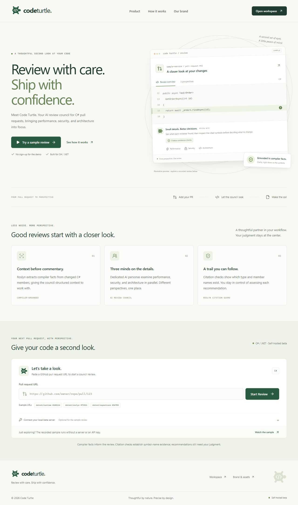
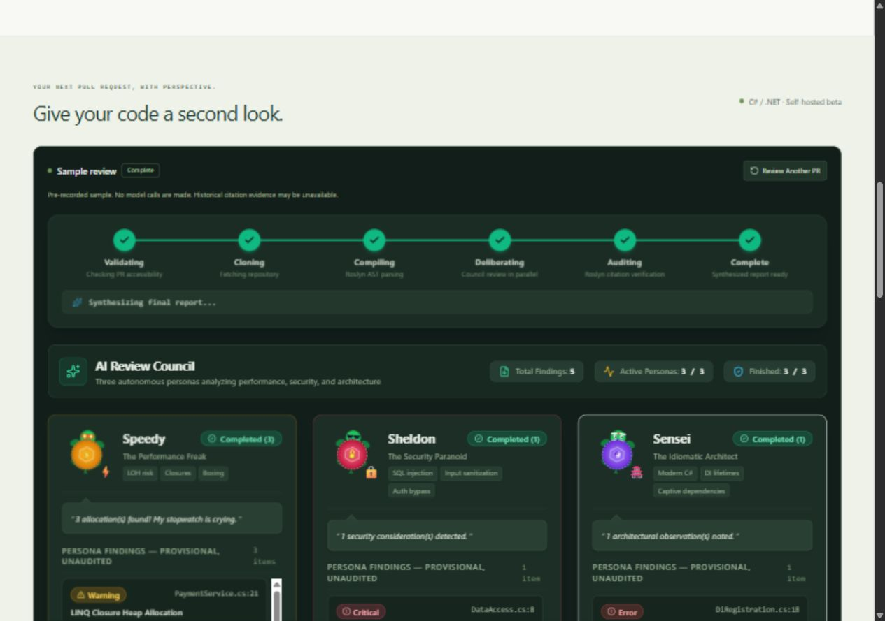
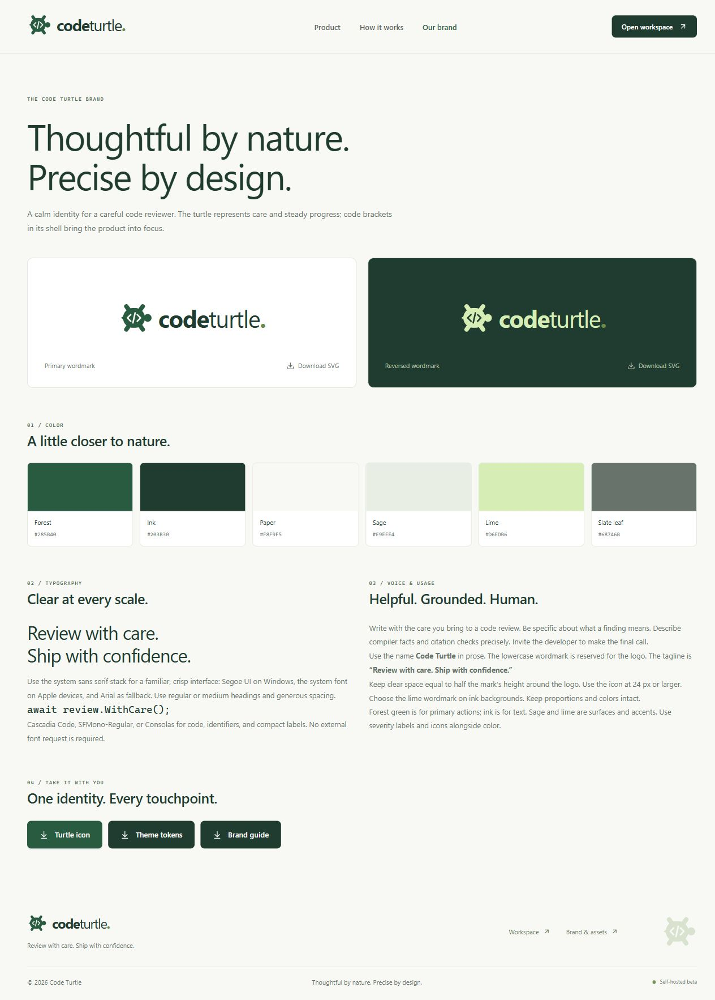

<p align="center">
  <picture>
    <source media="(prefers-color-scheme: dark)" srcset="public/brand/code-turtle-logo-reversed.svg">
    
  </picture>
</p>

# Code Turtle · Web UI

**Review with care. Ship with confidence.**

The Next.js 15 / React 19 interface for Code Turtle: a product page, C# review
workspace, recorded sample replay, and a reusable brand library.



## Run locally

Use Node 24.19.0. From the repository root:

```bash
cd web
npm ci
npm run dev
```

Open [localhost:3000](http://localhost:3000) for the product page and
[localhost:3000/brand](http://localhost:3000/brand) for the brand library.

Choose **Try a sample review** or **Watch the sample** to explore the recorded
review. The replay needs no server, account, access key, or model credentials.
It is historical sample data, not a fresh model run.

For a local production preview:

```bash
npm run build
npm start
```

## Review workspace



- A GitHub pull request input with URL validation and clearly labeled examples.
- Sample playback with pause, resume, speed selection, skip, and reset controls.
- Performance, security, and architecture personas with provisional findings.
- Citation evidence, severity/persona/keyword filters, and a final report.

Live reviews require a configured self-hosted backend and trusted repositories.
`NEXT_PUBLIC_API_BASE` selects that backend; if unset, live review requests use
`http://localhost:5000`. Leaving it unset does **not** disable live review controls.
The **Connect your local beta server** disclosure accepts the server's beta access
key, which is held in page memory for the session.

See [.env.example](.env.example), the [beta guide](../docs/beta/BETA.md), and
[isolation controls](../docs/ISOLATION.md) before enabling the API. A frontend
preview alone does not provide a hosted review service.

## Brand and theme

Use **Code Turtle** in prose and the lowercase **codeturtle.** wordmark in the logo.
The tagline is **Review with care. Ship with confidence.**



| Color | Value | Role |
|---|---|---|
| Forest | `#285B40` | Primary actions and icon |
| Ink | `#203B30` | Text and dark identity surfaces |
| Paper | `#F8F9F5` | Page background |
| Sage | `#E9EEE4` | Supporting surfaces |
| Lime | `#D6EDB6` | Accents and reversed logo |
| Slate leaf | `#68746B` | Supporting text |

Use the system sans serif stack for interface copy and Cascadia Code,
SFMono-Regular, or Consolas for code and compact labels. The UI needs no remote
font request. Keep functional copy readable, preserve visible keyboard focus,
and pair severity colors with text and icons.

| Asset | Source |
|---|---|
| Primary wordmark | [code-turtle-logo.svg](public/brand/code-turtle-logo.svg) |
| Reversed wordmark | [code-turtle-logo-reversed.svg](public/brand/code-turtle-logo-reversed.svg) |
| Turtle icon and favicon | [code-turtle-icon.svg](public/brand/code-turtle-icon.svg) |
| Portable theme tokens | [theme.css](public/brand/theme.css) |
| Logo usage, typography, and voice | [brand-guide.md](public/brand/brand-guide.md) |
| Product UI styles | [globals.css](src/app/globals.css) |
| Dark forest review palette | [tailwind.config.ts](tailwind.config.ts) |

The `/brand` page serves downloadable assets from `public/brand/`. The full guide
covers logo clear space, minimum size, color use, typography, and writing principles.

## Checks

```bash
npm test
npm run typecheck
npm run build
```

The frontend tests run without model credentials. See the [root README](../README.md)
for backend build commands, verification semantics, and benchmark provenance.

## Screenshots

The README images are actual captures of the local production UI. The review
workspace capture uses the completed recorded sample. A separate
[mobile capture](../docs/assets/mobile-preview.jpg) shows the product at 390 px.
See the [screenshot inventory](../docs/assets/README.md) for capture states and
refresh instructions.
