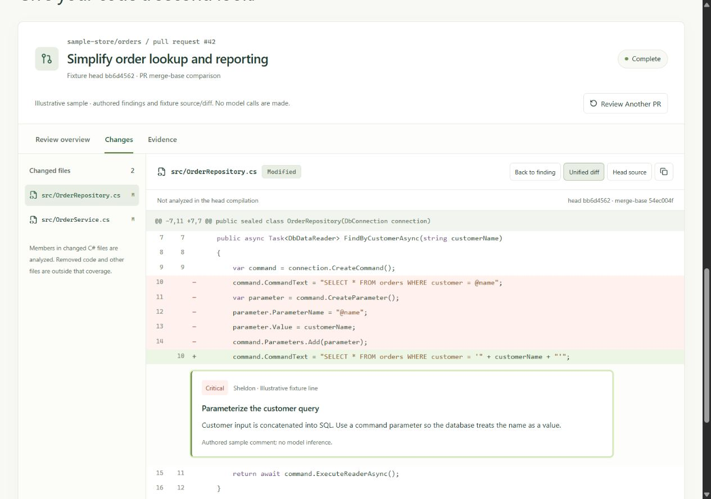

<p align="center">
  <picture>
    <source media="(prefers-color-scheme: dark)" srcset="public/brand/code-turtle-logo-reversed.svg">
    
  </picture>
</p>

# Code Turtle · Web UI

**Review with care. Ship with confidence.**

The Next.js 15 / React 19 interface for Code Turtle: a product page, C# review
workspace, and an illustrative sample with source diffs and inline comments.


## Run locally

Use Node 24.19.0. From the repository root:

```bash
cd web
npm ci
npm run dev
```

Open [localhost:3000](http://localhost:3000) for the product page.

Choose **Try a sample review** or **Explore sample review** to explore authored
review findings against a versioned source/diff fixture. Playback needs no server,
account, access key, or model credentials. It does not run a model or perform live
compilation. The original historical `demo-replay.json` remains unchanged in the
repository and is not used as evidence for this new source fixture.

For a local production preview:

```bash
npm run build
npm start
```

With no `NEXT_PUBLIC_API_BASE` configured at build time, this production preview
runs the sample and disables live submission. To test live reviews in a local
production preview, set `NEXT_PUBLIC_API_BASE=http://localhost:5000` in
`web/.env.local` before building. Rebuild after changing it; `npm start` cannot
change an API origin already embedded in the browser bundle.

## Review workspace


- A GitHub pull request input with URL validation and clearly labeled examples.
- Sample playback with pause, resume, speed selection, skip, and reset controls.
- A findings-first light workspace and compact performance/security/architecture reviewers.
- Separate Review overview, Changes, and Evidence areas with keyboard-accessible tabs.
- Retained/raw findings, severity/persona/keyword filters, and provenance in copied reports.
- Pinned head source, unified diffs, and inline comments with explicit anchor provenance.
- Clear failed-start, interrupted-stream, cancelled, degraded, and unavailable-evidence states.



Live comments anchor to a uniquely resolved compiler-supported member declaration,
not to a model-supplied line number. Uncertain findings remain in the list. Removed
code and non-C# files are labeled outside analysis coverage. GitHub posting and
split diff are not implemented in this increment.

Live reviews require a running trusted-local backend and allowlisted repositories.
In development, an unset or blank `NEXT_PUBLIC_API_BASE` uses
`http://localhost:5000`. Production builds require an explicit valid HTTP(S)
backend origin; otherwise the entry explains local setup before submission and
keeps the sample available. Never include access keys in this public variable.
The **Connect your local beta server** disclosure appears when a connection is
configured and accepts the server's beta access key, held in page memory.
Use the same hostname for both services (for example, `localhost` for both), so the
short-lived session cookie can be used by the browser. Source artifacts are bound
to the creating session, held in memory, and expire with the review job. The UI
shows an explicit unavailable state when an artifact cannot be retrieved.

See [.env.example](.env.example), the [beta guide](../docs/beta/BETA.md), and
[isolation controls](../docs/ISOLATION.md) before enabling the API. A frontend
preview alone does not provide a hosted review service. The public Vercel site is
a frontend/sample experience; its build must not point at `localhost`. The current
API accepts loopback clients only, so run the UI locally alongside it. See the
[local web setup steps](../docs/beta/BETA.md#run-the-local-web-ui) for exact origins,
keys, repository allowlists, and connection troubleshooting.

## Checks

```bash
npm test
npm run typecheck
npm run build
```

The frontend tests run without model credentials. See the [root README](../README.md)
for backend build commands, verification semantics, and benchmark provenance.

## Screenshots

The README images are actual captures of the local production UI. The review
workspace capture uses the completed illustrative sample. A separate
[mobile capture](../docs/assets/mobile-preview.jpg) shows the product at 390 px.
See the [screenshot inventory](../docs/assets/README.md) for capture states and
refresh instructions.

To regenerate the versioned source/diff sample from deterministic local Git commits:

```bash
node tools/generate_workspace_demo.mjs # run from repository root
```

This regenerates only the two `workspace-*.v1.json` fixtures. It makes no network or
model calls and preserves the historical replay and benchmark artifacts.
